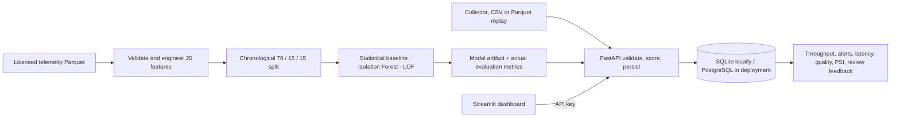

# GameGuard

**GameGuard scores GPU/CPU hardware telemetry collected during a game session and flags unusual measurements for investigation.** It does not identify cheating or malicious behavior. Its anomaly score is not a probability.

This is a reproducible, unsupervised telemetry monitoring system: licensed Parquet data, validation and feature engineering, Isolation Forest with two comparison baselines, a versioned trained model, FastAPI scoring and ingestion, SQLite/PostgreSQL persistence, reviewer feedback, monitoring metrics, Streamlit dashboard, Docker Compose, GitHub Actions, and a Render deployment blueprint.

## Data status and limitations

The selected public dataset is `rmems/gaming-telemetry`, configuration `re4`: 95,893 rows from one roughly 90-minute Resident Evil 4 Remake capture on one RTX 5080 workstation. Its dataset card declares MIT or Apache-2.0 licensing. It is genuine hardware telemetry but has no anomaly labels and reports no thermal or hardware-slowdown incidents. It does not contain player behavior, inputs, or outcomes. Results cannot establish anomaly precision/recall or generalization across games or machines. The raw Parquet is downloaded locally and excluded from Git. See [dataset card](docs/dataset-card.md), [model card](docs/model-card.md), and the measured [evaluation JSON](artifacts/models/gameguard-if-v1/metrics.json).

## Architecture



See [architecture](docs/architecture.md) and [API reference](docs/api.md).

## Quick start with Docker

Requirements: Git, Docker Desktop with the Linux Engine running, and Python only if you plan to train locally.

```powershell
Copy-Item .env.example .env
docker compose up --build
```

Open the dashboard at `http://localhost:8501`; API docs are at `http://localhost:8000/docs`. The first start applies the database migration. Upload source-schema CSV or Parquet in **Live Telemetry** to score real events. The Docker image contains the trained model artifact and does not include raw telemetry.

## Train and reproduce

```powershell
py -3.11 -m venv .venv
.\.venv\Scripts\Activate.ps1
python -m pip install -r requirements-dev.txt
python -m pip install -e . --no-deps
python scripts/download_data.py
python -m gameguard.train --data data/raw/re4/train-00000.parquet --output-dir artifacts/models/gameguard-if-v1
```

Training validates the 19-column source schema, timestamps, duplicates, source ranges, and missing readings. It transforms documented fields into 20 numeric features; timestamp and session label are not used as model features. It trains on the first 70% of time, selects the score threshold from the next 15% to target 1% validation alerts, then reports the last 15% as a held-out later-time diagnostic. Candidates are robust statistical thresholds, Isolation Forest, and Local Outlier Factor fit on up to 5,000 seeded rows. No supervised metrics are reported because no trusted labels exist.

The command writes `model.joblib`, `model-info.json`, and `metrics.json`; the model artifact and measured metrics are versioned in Git. The large licensed raw dataset stays in ignored `data/raw/`. The synthetic extreme-value check is labeled as a scoring-path sanity check, not real-world recall.

## Run without Docker

Run these from the repo root after installing dependencies and training the model:

```powershell
python -m gameguard.migrate
uvicorn gameguard.api:app --reload
```

In another terminal:

```powershell
$env:API_BASE_URL = "http://127.0.0.1:8000"
streamlit run dashboard/app.py
```

The default local database is SQLite at `data/gameguard.db`. Use PostgreSQL for a shared deployment. If `API_KEY` is set, pass it as `X-API-Key`; API and dashboard can both read it from environment variables.

## Replay telemetry and API

Download the data, start the API, then replay at a configurable rate:

```powershell
python scripts/replay_data.py --rate 10 --limit 100
```

The dashboard can also upload source-schema CSV or Parquet in chunks. It labels these as replayed telemetry; it does not connect to a live game. Key endpoints:

| Endpoint | Use |
| --- | --- |
| `GET /health`, `GET /ready` | Liveness and dependency readiness |
| `GET /v1/model/info` | Active model, threshold, feature schema, split metadata |
| `POST /v1/score` | Validate and score one event without persistence |
| `POST /v1/events` | Score and persist one idempotent event |
| `POST /v1/events/batch` | Ingest up to 200 events |
| `GET /v1/alerts` | Filter and paginate flags |
| `PATCH /v1/alerts/{event_id}/feedback` | Save a human review status and note |
| `GET /v1/metrics/summary` | Persisted event, alert, quality, feedback, and latency metrics |
| `GET /v1/monitoring` | Data drift (PSI) and operational monitoring |
| `GET /metrics` | Prometheus text metrics |

All `/v1/*` endpoints and `/metrics` require `X-API-Key` when `API_KEY` is configured. The service rejects extra fields, caps batches at 200, and applies a per-process limit of 120 API calls per client address per minute. More request/response details and a PowerShell example are in [docs/api.md](docs/api.md).

## Dashboard

The dashboard includes Overview, Live Telemetry, Anomaly Explorer, Model Performance, Data Quality, Monitoring, and Model & Dataset pages. Operational cards query the backend; evaluation tables read the saved measured report. Empty histories remain empty rather than displaying invented traffic. Review feedback is persisted but does not trigger automatic retraining.

## Metrics

The trained model's measured offline alert rates are:

| Detector | Validation alerts (14,384 rows) | Later-time test alerts (14,384 rows) | Test alert-rate range across five time blocks |
| --- | ---: | ---: | ---: |
| Isolation Forest (primary) | 1.001% | 5.026% | 18.67 percentage points |
| Robust statistical thresholds | 1.168% | 3.824% | 19.05 percentage points |
| Local Outlier Factor | 1.001% | 1.550% | 7.72 percentage points |

The Isolation Forest threshold is the 99th percentile of validation scores. Its test rate rises above the intended 1% validation alert budget and varies substantially over time. These are unlabeled-data alert rates, not accuracy or recall. A synthetic 128-row scoring check found every injected score above its paired control score, but only 4.69% of injected events crossed the model threshold; synthetic inputs are not evidence of real anomaly detection. Training plus evaluation took 12.37 seconds on the training machine. The complete checksum, score quantiles, block rates, data validation, and run measurements are in [`metrics.json`](artifacts/models/gameguard-if-v1/metrics.json).

`/v1/metrics/summary` and `/metrics` report measured traffic throughput, alert rate, quality, score distribution, process resources, error count, and scoring latency. `/v1/monitoring` includes PSI when at least 50 recent events exist. PSI indicates input feature distribution change, not model-performance degradation. A local loopback run on this workstation completed 80 synthetic requests at concurrency 5 with 0 errors, 5.97 requests/sec, and p50/p95/p99 request latency of 530/2,210/4,164 ms. These are a single machine-specific SQLite-backed run, not a production capacity estimate. The measured results and smoke checks are in [`local-smoke-metrics.json`](docs/local-smoke-metrics.json). Run `python scripts/load_test.py --requests 100 --concurrency 5` against a running API to repeat the synthetic test on another host.

## Tests and CI

```powershell
ruff format --check .
ruff check .
pytest
```

GitHub Actions runs the same lint/tests and builds the Docker image. It does not automatically provision or deploy cloud resources.

## Deploy

`render.yaml` defines the API and dashboard as free Render web services. The deployed API uses a separate Neon PostgreSQL project; the pooled connection string is stored only as Render's `DATABASE_URL` secret and is excluded from Git. Both services communicate over their public HTTPS URLs because Render's free web services cannot use private service networking. See the [deployment runbook](docs/deployment.md) and [verified deployment status and metrics](docs/deployment-status.md). Free Render services can sleep when idle, and the Neon Free plan has usage limits; this setup is for a demo, not sustained production use.

## Responsible use

Unusual is not malicious. Use flags for operator review; do not automatically punish, ban, rank, or profile players from these scores. Validate the detector against representative, properly licensed target-game data with reviewed incidents before using it operationally. Do not upload personal or sensitive telemetry to the demo service.
