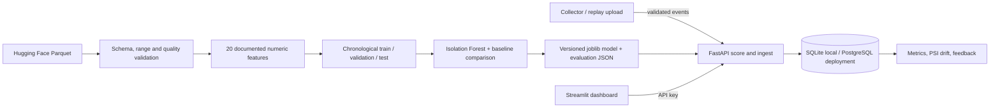

# Architecture

The source records GPU/CPU hardware readings during one game session. It contains no video, player inputs, player account IDs, or anomaly labels. GameGuard scores system telemetry that may be unusual relative to the training capture. It cannot support player-behavior or anti-cheat conclusions.

Offline training owns data validation, derived features, temporal splitting, candidate detectors, validation threshold selection, and artifact output. Runtime only loads the versioned artifact. A scoring request does not retrain the model. The event endpoint validates and scores an event, then stores its event ID, timestamp, telemetry payload, score, flag, model version, feature evidence, data-quality status, latency, and reviewer feedback. Repeated IDs return the previously stored result.

`POST /v1/events/batch` processes up to 200 events and commits each event separately so a duplicate does not roll back unrelated rows. The default SQLite database supports local use; PostgreSQL is used by Compose and the Render blueprint. Alembic migrations define the persistent schema.

The model card and dataset card describe limited provenance and external validity. Threshold selection enforces a validation alert budget, not precision or recall. Synthetic extreme-value checks exercise detection wiring but are not treated as ground truth. PSI compares recent feature distributions with the training split and is a data-drift signal only. Reviewer labels are stored, never used for automatic production retraining.
